# 拾光旅伴 H5 V5 部署秒哒前审计报告

审计日期：2026-08-03  
审计对象：`/Users/BitLukou-004/Desktop/拾光旅伴-H5-v5.zip` 及其对应本地源码  
审计结论：**暂不建议直接导入秒哒上线（NO-GO）**。前端页面可构建、三端主要 H5 视觉链路基本可用，但存在账号测试后门、Edge Function 语法错误、明文密钥打包、生产后端部署缺口等阻断项。

## 1. 执行摘要

V5 的主要优点是三端视觉体系已经基本统一，390×844 下房间、记录、个人中心、上传、直播等关键页面没有发现普遍性遮挡；50 个 QA 页面/操作后状态均能渲染，当前截图环境中未记录页面控制台异常。参与记录、已结束房间字幕/会议纪要访问也已有迁移支持。

但是当前 ZIP 不能作为生产部署包直接交给秒哒：

1. 生产前端保留了固定测试手机号与固定验证码逻辑，且 `dev-test-login` 云函数宣称“生产禁用”但代码没有环境判断，属于账号登录后门。
2. `delete-account` Edge Function 在第 424 行开始出现重复代码与裸 `*`，无法解析和部署，注销账号功能必然失败。
3. ZIP 内含 3 个真实环境文件及多组服务端密钥明文。虽然服务端密钥没有进入本次 `dist`，但 ZIP 本身一旦上传、转交或进入日志即产生泄露面。
4. 秒哒导入前端代码不会自动完成 Supabase migrations、Edge Functions、Secrets、RTC/ASR WebSocket 网关部署；这些后端资产缺一项，页面仍能打开，但语音、翻译、字幕、注销、持久化会局部或整体失败。
5. 用户协议/隐私政策仍明确使用临时运营主体，不能作为正式公开发布版本。

## 2. 部署门禁问题

### P0｜必须在导入/发布前修复

#### P0-1 固定测试账号可在生产环境绕过短信验证

- 前端 `src/contexts/AuthContext.tsx:130-158` 无条件内置测试号码和固定验证码，并调用 `dev-test-login`。
- `supabase/functions/dev-test-login/index.ts:10` 的注释声称生产禁用，但实现中没有读取或校验 `ENVIRONMENT`。
- `supabase/migrations/00053_*`、`00054_*` 会创建测试账号；V5 ZIP 中也包含这些文件。
- 影响：任何知道固定组合的人都可在正式环境获取有效 session，并继续切换三种身份。
- 处理：生产构建移除前端白名单；生产数据库不执行测试账号迁移；生产环境不部署该函数，或在服务端加入默认拒绝的环境门禁并做回归测试。

#### P0-2 注销账号 Edge Function 无法编译

- `supabase/functions/delete-account/index.ts:424` 出现裸 `*`，随后整段函数重复；文件内有两次 `import createClient` 和两次 `Deno.serve`。
- 独立 TypeScript 解析结果：仅该函数失败，错误为 `Unexpected "*"`；其他 7 个函数通过语法解析。
- 影响：个人中心虽然展示“注销账号”，调用时会失败；秒哒/Supabase 也无法部署该函数。
- 处理：保留一份完整实现，删除重复残段；在独立测试项目验证导游、游客、摄影师三种账号的数据库与 Storage 清理顺序。

#### P0-3 V5 ZIP 含明文生产凭证

- ZIP 包含 `.env`、`supabase/.env.local`、`supabase/.env.development.local`。
- 已确认其中配置了 Supabase、百度语音/翻译、百度 RTC 等凭证；本报告不记录具体值。
- 本次产物扫描结果：Supabase URL、anon key、公开 App ID 进入浏览器 bundle；百度服务端密钥未进入 `dist`。前者是预期的客户端配置，后者仍因 ZIP 明文而有泄露风险。
- 处理：不要把含真实密钥的 ZIP 直接交给生成式对话或公共附件；服务端密钥改由秒哒/后端 Secret 管理。若 V5 已上传到任何不受控位置，应立即轮换相关密钥。

#### P0-4 秒哒前端导入不等于后端部署

V5 依赖下列外部资产：

- 69 份 Supabase migration；
- 8 个 Edge Function；
- Supabase Auth、Realtime、Storage buckets 与 RLS；
- 百度 RTC Token 函数及 `BAIDU_RTC_APP_ID/APP_KEY`；
- 百度 ASR、翻译、TTS Secrets；
- 生产 `wss://` 实时语音识别网关。

只导入 React/Vite 代码不会自动创建这些资产。发布前必须用与 V5 完全匹配的后端环境逐项部署和验收，不能用“页面能打开”代替业务通过。

#### P0-5 正式合规文案未完成

- `src/lib/legalContent.ts:7-10` 明确要求补充真实运营主体、注册地址和有效联系方式，并注明当前临时称谓不得用于正式合规材料。
- 处理：上线登录、采集手机号、录音和照片前，补齐真实主体、权限用途、保存期限、撤回/注销路径和联系渠道，并由实际运营方审核。

### P1｜上线前强烈建议修复

#### P1-1 生产质量检查存在“假通过”

- `npm run typecheck`：通过。
- `npm run build`：通过。
- `npm run lint`：退出码为 0，但输出了 2 个 TypeScript 错误，并连续提示 `ast-grep: command not found`。
- 原因：lint 脚本用分号串联命令，没有 `set -e`，早期失败被最后一个构建命令覆盖。
- 影响：CI 会显示绿色，但类型/规则检查实际未全部执行；Edge Functions 又不在前端 tsconfig 范围内。
- 处理：所有检查 fail-fast；增加 Edge Function 解析、migration 校验和生产构建检查。

#### P1-2 依赖存在 1 个高危漏洞

- `pnpm audit --prod --audit-level high` 报告 `react-router` 高危安全公告，当前锁定范围受影响。
- 处理：评估升级至已修复版本，并执行登录、hash 路由、角色守卫、邀请链接回归。

#### P1-3 未使用但可部署的开放注册函数权限过大

- `register-user` 不要求已登录，直接使用 service role 创建用户；前端当前没有调用该方法，但函数存在于部署目录。
- 处理：生产不部署未使用函数；若保留，增加业务级授权、频率限制、密码策略与审计日志。

#### P1-4 百度 RTC 与降级 WebRTC 仍有生产缺口

- 百度 RTC token 有效期为 2 小时，客户端未实现到期前刷新/重连；长场次存在中断风险。
- 云端 token 以“房间 + Supabase 用户 ID”生成 RTC userId；若导游与游客共用同一登录账号测试，会发生同 userId 冲突。
- WebRTC 降级仅配置公共 STUN，没有 TURN；跨运营商、企业网、蜂窝网和对称 NAT 下可能无法建立音频连接。
- 秒哒若以 iframe/WebView 承载，还必须验证 HTTPS、麦克风 Permissions Policy、iframe `allow` 与音频自动播放手势。
- 处理：真实两账号、两运营商、锁屏/切后台、2 小时场次、弱网重连均需实机验收。

#### P1-5 实时字幕生产网关未形成可部署闭环

- `VITE_STREAMING_ASR_WS_URL` 当前未配置，生产环境会降级为分段短语音识别。
- 本地 Vite 的 `/api/local/baidu/*` 插件不会存在于秒哒正式运行环境。
- 处理：提供生产 `wss://` 网关及鉴权、限流、断线续传策略；否则应在产品上明确“分段识别”能力，而不是承诺实时连续字幕。

#### P1-6 部署目标和邀请链接/数据库绑定需确认

- 邀请链接生产域名硬编码为 `https://app-d04hti6zlz42.appmiaoda.com`。
- `.env` 中 Supabase URL 也绑定现有后端项目。
- 如果 V5 导入的是另一个秒哒应用，分享链接会跳回旧应用，数据也可能继续写入旧项目。
- 处理：将部署域名和后端项目作为环境配置；导入目标若仍是同一 appId，也需在发布后验证分享、邀请、回跳和数据库一致性。

#### P1-7 角色路由守卫遗漏 `records`

- `records` 在页面清单和 switch 中存在，但没有进入 `GUIDE_ONLY_PAGES`。
- 影响：游客或摄影师可通过直接修改 hash 打开导游记录页。RLS 应继续阻断数据，但 UI 级角色隔离不完整。
- 处理：补齐路由守卫，并对所有 50 个页面 ID 做角色矩阵单元测试。

## 3. UI / H5 截图审计

证据目录：`audit/v5-pre-miaoda-2026-08-03/screens/`。本轮新采集并检查了 14 个 390×844 关键页面、5 个 320×844 窄屏页面和 6 个长页面底部状态；同时遍历了 QA harness 中 50 个页面/操作后状态。以下判断仅代表 mock 数据和本地浏览器视觉，不代表真实后端成功。

### 1）游客房间发现｜健康

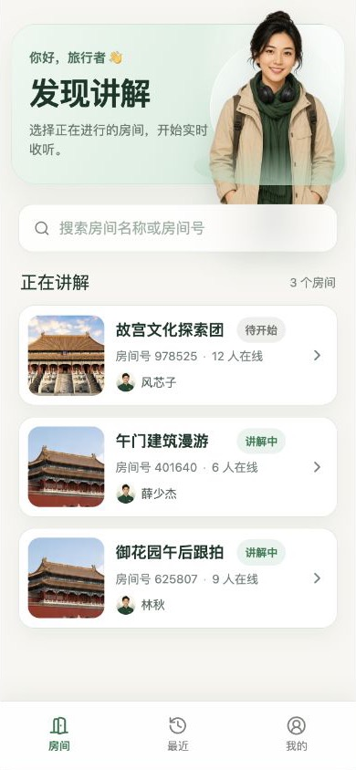

- 390px 下欢迎区、搜索、列表和底栏层级清晰，人物溢出关系成立。
- 320px 下标题被强制换成两行，房间名大量省略；功能可用，但信息辨识度明显下降。
- 建议：320px 不再进一步缩小字体，优先压缩图片宽度、徽标和左右留白。

### 2）游客最近记录｜基本健康

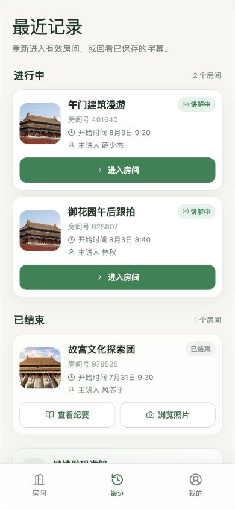

- 进行中/已结束分组、进入房间/查看纪要/浏览照片动作清楚，长列表底部留白足够，未被底栏遮挡。
- 列表元信息主要使用小号浅灰字，户外和低亮度屏幕下可读性偏弱。

### 3）游客实时收听｜需关注

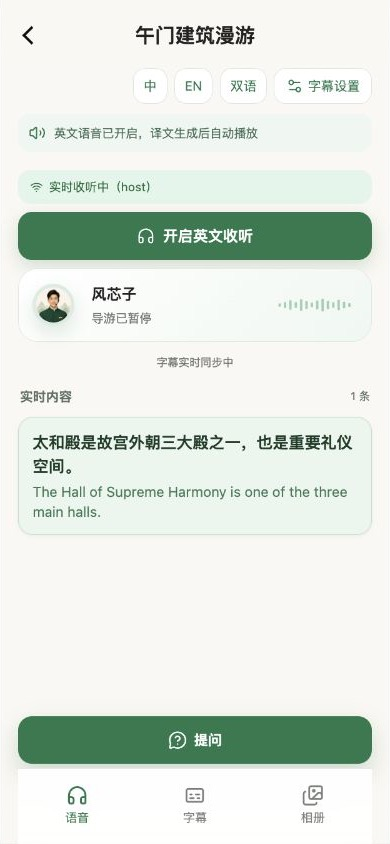

- 核心动作“开启英文收听”和底部“提问”突出，字幕块层级合理。
- 状态、同步提示和部分次要文本约 10–12px；对于移动 H5 偏小。
- 语音页面是否可用取决于用户手势、麦克风/播放权限和 RTC，而非截图本身。

### 4）导游主页与记录｜基本健康

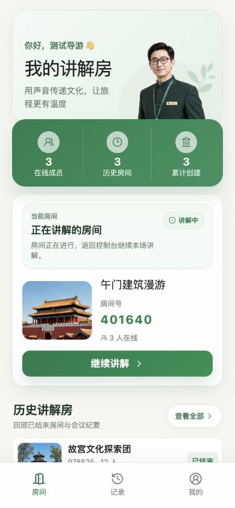

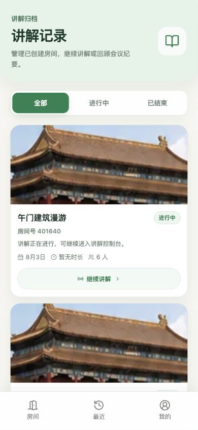

- 当前房间和继续讲解动作明确，记录页采用大图卡片后整体风格统一。
- 320px 记录卡的大图占比很高，首屏可见条数低；长房间名和长讲解说明会明显增加滚动成本。
- 记录页应补充超长标题、100 条列表、无封面图、图片加载失败的视觉状态验收。

### 5）导游直播控制台｜需真实链路验收

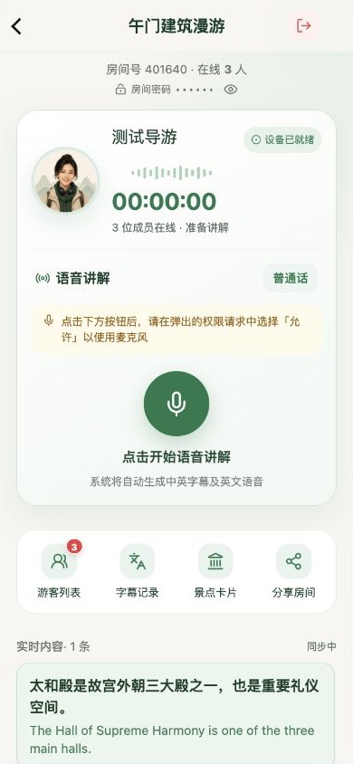

- 计时、设备状态、麦克风主按钮、游客/字幕/卡片/分享工具层级清晰。
- 房间密码在页面可切换显示，适合现场分享，但需要防止录屏/投屏泄露。
- 双语长字幕会持续增长，应在 320px、最大字号、连续 50 条和键盘弹出状态下继续检查滚动锚点。

### 6）摄影师任务与上传｜基本健康

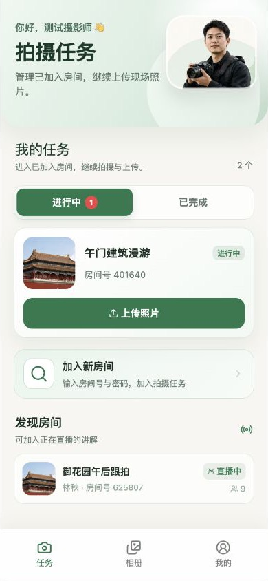

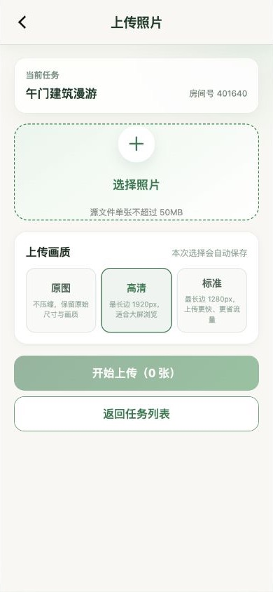

- 任务、加入、上传和发现房间的视觉优先级成立；上传页主要动作与画质选项明确。
- 320px 下说明文字发生 2–3 行折行，房间卡仍能操作。
- 仍需真实测试：50MB 边界、HEIC/超长图、断网重试、并发多图、后台切换和失败后持久恢复。

### 7）三端“我的”页｜需统一收尾

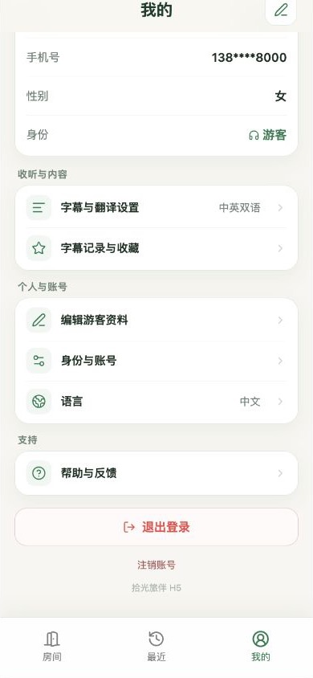

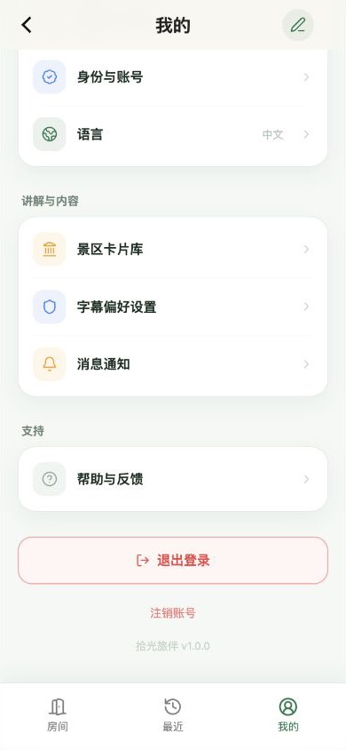

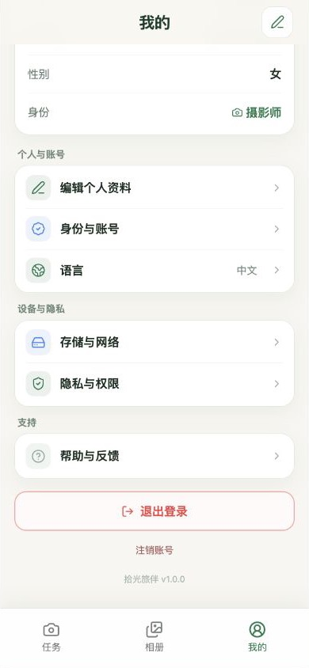

- 三端菜单卡、退出登录、注销账号和底栏结构一致，底部状态未发现遮挡。
- 页脚仍不统一：游客为“拾光旅伴 H5”，导游/摄影师为“拾光旅伴 v1.0.0”；尚未完成此前要求的秒哒技术支持品牌页脚。
- 整体使用大量 11–12px 次要文字；建议以 13–14px 为正文下限，12px 仅用于短标签，同时确保 44×44px 触控区。

## 4. 代码与可维护性

### P2 问题

- `src/index.css` 已达 7,797 行，存在多轮角色端覆盖层和媒体查询叠加。短期视觉成立，但后续改一个组件容易影响另一端或仅在 320px 回归。
- 生产 CSS 为 336.66KB（gzip 61.98KB），主要 JS chunks 合计约 1.17MB 未压缩；弱网首屏应继续做真机性能测试。
- `package.json` 未声明 Node/pnpm 版本；秒哒构建环境可能使用不同版本，建议声明 `packageManager` 和 `engines`。
- Supabase migrations 数量多且包含测试账号迁移、同前缀文件，部署前需要一份明确的生产迁移白名单，而不是整个目录无差别执行。
- 多处 CORS 使用 `Access-Control-Allow-Origin: *`；对需要 Bearer token 的接口虽不直接等同于越权，但应收紧正式域名并检查预检头。

## 5. 已验证与未验证范围

### 已验证

- V5 ZIP 完整性：通过，共有环境文件 3 个。
- `npm run typecheck`：通过。
- `npm run build`：通过。
- Edge Function 语法解析：7 个通过，`delete-account` 失败。
- 生产依赖审计：发现 1 个高危漏洞。
- 50 个 QA 页面/状态：均有 DOM 输出，本轮截图环境无页面级控制台错误。
- 390×844、320×844 视觉；个人页、记录页、主页等长滚动底部状态。

### 未验证，不能据此宣称通过

- 秒哒正式构建、发布和 iframe/WebView 权限；
- 真实 Supabase migrations/Functions/Secrets 部署；
- 两个独立真实账号、跨运营商网络的百度 RTC 音频；
- TURN 降级链路、2 小时 token 续期、弱网重连；
- 百度实时 ASR、翻译、TTS 全链路；
- 真机 iOS Safari、Android 微信内置浏览器；
- 真实大文件上传、Storage 权限、断点恢复；
- 注销账号的数据与文件不可逆清理；
- 法务/隐私合规审核。

## 6. 建议的上线顺序

1. **安全清理**：移除生产测试登录、测试账号迁移和未使用高权限函数；轮换任何已外发 ZIP 中的服务端密钥。
2. **修复阻断**：修好并独立部署 `delete-account`；让 lint/Edge Function/migration 检查真正失败即红灯。
3. **确定部署边界**：确认秒哒目标 appId、Supabase 项目和正式邀请域名；制定 migration/function/secret 白名单。
4. **后端先行**：部署数据库、RLS、Storage、Edge Functions、百度 Secrets 和生产 WSS 网关。
5. **再导入前端**：只携带源码和公开配置；服务端密钥由安全 Secret 注入，不放在 ZIP。
6. **三设备验收**：导游电脑、游客 iPhone、游客 Android，分别用 Wi-Fi/5G/不同运营商完成创建房间→加入→语音→字幕→照片→结束→会议纪要→持久回看。
7. **发布门禁**：320/390 视觉、无障碍字号、错误态、长列表、注销和隐私文案全部签字后再公开发布。

## 7. 最终准入判断

当前 V5 可作为“UI 与业务代码候选版本”继续整改，但**不是可直接部署上线的生产包**。至少完成 P0-1 至 P0-5 后，才建议进入秒哒测试环境；完成 P1-1 至 P1-7 并通过真实设备/真实后端验收后，才建议公开发布。
